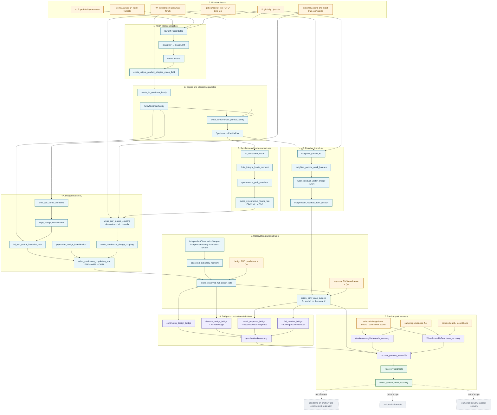

# WMFKI formalization: dependency graph of major declarations

This graph displays the declarations needed to understand the main mathematical route, rather than all 437 new declarations. The complete audited inventory is recorded in [`WMFKI_Stochastic/Audit.lean`](../WMFKI_Stochastic/Audit.lean) and [`SOURCE_MANIFEST.json`](../WMFKI_Stochastic/SOURCE_MANIFEST.json).

- Blue: constructed or proved in Lean
- Purple: bridge to the existing production definitions and recovery API
- Green: final output
- Yellow: explicit assumptions retained at application time
- Gray: outside the present formalization



## Correspondence between the paper and Lean

| Role in the paper | Main Lean declaration | File |
|---|---|---|
| Construction and uniqueness of the mean-field equation | `exists_unique_product_adapted_mean_field` | [`MeanFieldWellPosedness.lean`](../WMFKI_Stochastic/MeanFieldWellPosedness.lean) |
| iid nonlinear copies | `exists_iid_nonlinear_family` | [`NonlinearCopiesFromInputs.lean`](../WMFKI_Stochastic/NonlinearCopiesFromInputs.lean) |
| Synchronous interacting particle system | `exists_synchronous_particle_family` | [`SynchronousArrayEquation.lean`](../WMFKI_Stochastic/SynchronousArrayEquation.lean) |
| Synchronous fourth-moment rate | `exists_synchronous_fourth_rate` | [`SynchronousFourthRate.lean`](../WMFKI_Stochastic/SynchronousFourthRate.lean) |
| Feature stability | `exists_continuous_design_coupling` | [`ActualDesignCoupling.lean`](../WMFKI_Stochastic/ActualDesignCoupling.lean) |
| P2 bound for the iid-pair design | `iid_pair_matrix_frobenius_rate` | [`IIDPairMatrix.lean`](../WMFKI_Stochastic/IIDPairMatrix.lean) |
| Identification with the actual population design | `population_design_identification` | [`PopulationFeatureLaw.lean`](../WMFKI_Stochastic/PopulationFeatureLaw.lean) |
| Continuous-design convergence (Theorem 4.9 type) | `exists_continuous_population_rate` | [`ContinuousPopulationRate.lean`](../WMFKI_Stochastic/ContinuousPopulationRate.lean) |
| Observed-design budget D₀ | `exists_observed_full_design_rate` | [`ActualObservedDesign.lean`](../WMFKI_Stochastic/ActualObservedDesign.lean) |
| Joint D₀/V₀ budgets on one realization (Theorems 4.8–4.9 type) | `exists_joint_weak_budgets` | [`JointWeakBudgets.lean`](../WMFKI_Stochastic/JointWeakBudgets.lean) |
| Connection to the production recovery API | `recover_genuine_assembly` | [`RecoveryCertificate.lean`](../WMFKI_Stochastic/RecoveryCertificate.lean) |
| Random-pair recovery (Theorem 4.12 type) | `exists_particle_weak_recovery` | [`PrimitiveRecovery.lean`](../WMFKI_Stochastic/PrimitiveRecovery.lean) |

## How to read the final theorem

The quantifier order in `exists_particle_weak_recovery` is:

```text
primitive inputs
  → ∃ Y, R, Rpos, CA, CV
  → ∀ N > 0, ∃ BN, X
  → for every finite grid, observation noise system, e, and q
  → D₀ bound ∧ V₀ bound ∧ RecoveryCertificate
```

Thus, `CA` and `CV` are not chosen separately for each `N`. The theorem also does not take `D₀`, `V₀`, or the unknown trajectories as primitive assumptions.

## Explicit assumptions and scope boundaries

### Explicit assumptions

- RMS quadrature accuracy for the design and response
- Exact representation of the true kernel by the dictionary
- Lower bound for the selected OLS population design
- Cone lower bound and column bound for LASSO
- Sampling smallness, `δ`, `ε`, a positive penalty, and the penalty lower bound

### Outside the present formalization

- Universal transfer to an arbitrary pre-existing joint realization
- Additional adaptedness of the copies to a newly constructed particle filtration
- Uniform-in-time rates
- Measurability of the estimators themselves
- Correctness of a numerical solver
- Support recovery

## Viewing the graph

GitHub and Mermaid-enabled Markdown previews render the diagram directly. The concept-oriented one-page English version, including this graph, is [`formalization-map-en.html`](formalization-map-en.html).
