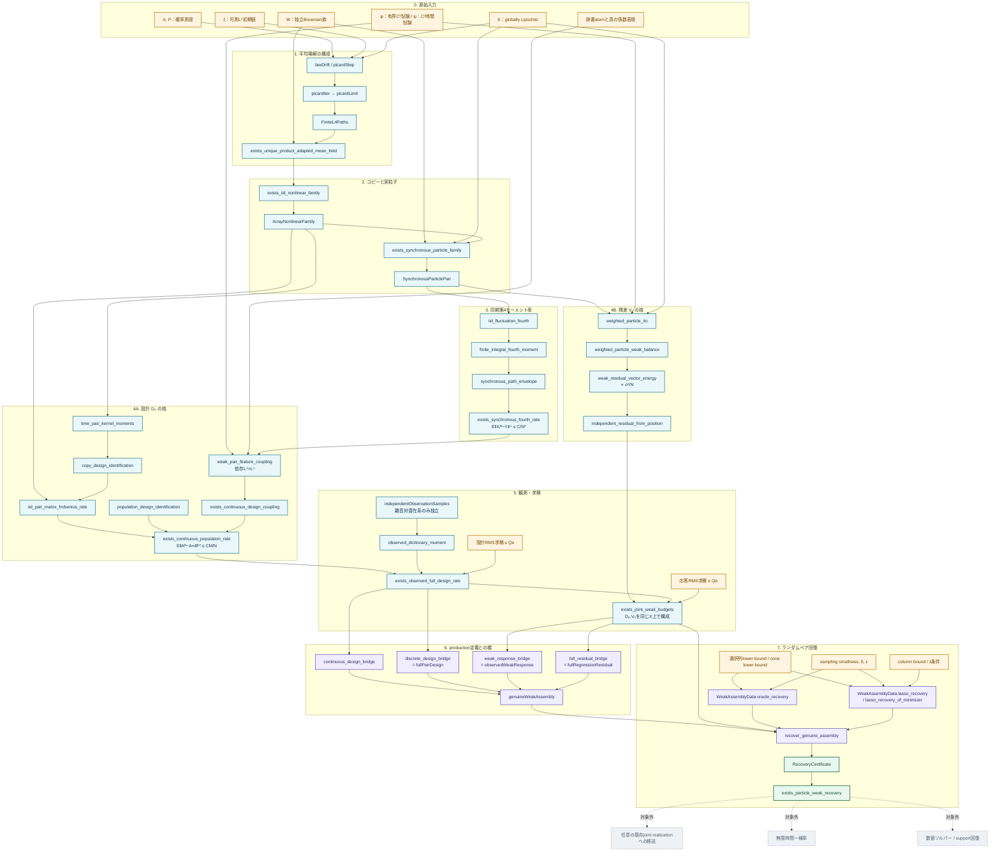

# WMFKI形式化：主要宣言の依存グラフ

この図は、新規437宣言のうち、数学的な流れを把握するための主要宣言だけを表示します。完全な監査対象一覧は [`WMFKI_Stochastic/Audit.lean`](../WMFKI_Stochastic/Audit.lean) と [`SOURCE_MANIFEST.json`](../WMFKI_Stochastic/SOURCE_MANIFEST.json) にあります。

- 青：Leanが構成・証明した宣言
- 紫：既存production定義・回復APIとの橋
- 緑：最終出力
- 黄：適用時に残す明示的仮定
- 灰：今回の対象外



## 原稿とLeanの対応

| 原稿上の役割 | 主要Lean宣言 | ファイル |
|---|---|---|
| 平均場方程式の構成・一意性 | `exists_unique_product_adapted_mean_field` | [`MeanFieldWellPosedness.lean`](../WMFKI_Stochastic/MeanFieldWellPosedness.lean) |
| iid非線形コピー | `exists_iid_nonlinear_family` | [`NonlinearCopiesFromInputs.lean`](../WMFKI_Stochastic/NonlinearCopiesFromInputs.lean) |
| 同期粒子系 | `exists_synchronous_particle_family` | [`SynchronousArrayEquation.lean`](../WMFKI_Stochastic/SynchronousArrayEquation.lean) |
| 同期第4モーメント率 | `exists_synchronous_fourth_rate` | [`SynchronousFourthRate.lean`](../WMFKI_Stochastic/SynchronousFourthRate.lean) |
| 特徴安定性 | `exists_continuous_design_coupling` | [`ActualDesignCoupling.lean`](../WMFKI_Stochastic/ActualDesignCoupling.lean) |
| iidペア設計のP2評価 | `iid_pair_matrix_frobenius_rate` | [`IIDPairMatrix.lean`](../WMFKI_Stochastic/IIDPairMatrix.lean) |
| 実母集団設計との同定 | `population_design_identification` | [`PopulationFeatureLaw.lean`](../WMFKI_Stochastic/PopulationFeatureLaw.lean) |
| 連続設計収束（4.9型） | `exists_continuous_population_rate` | [`ContinuousPopulationRate.lean`](../WMFKI_Stochastic/ContinuousPopulationRate.lean) |
| 観測を含むD₀ | `exists_observed_full_design_rate` | [`ActualObservedDesign.lean`](../WMFKI_Stochastic/ActualObservedDesign.lean) |
| 同じ実現上のD₀/V₀（4.8–4.9型） | `exists_joint_weak_budgets` | [`JointWeakBudgets.lean`](../WMFKI_Stochastic/JointWeakBudgets.lean) |
| production回復APIへの接続 | `recover_genuine_assembly` | [`RecoveryCertificate.lean`](../WMFKI_Stochastic/RecoveryCertificate.lean) |
| ランダムペア回復（4.12型） | `exists_particle_weak_recovery` | [`PrimitiveRecovery.lean`](../WMFKI_Stochastic/PrimitiveRecovery.lean) |

## 最終定理を読むときの要点

`exists_particle_weak_recovery`の量化順序は次です。

```text
原始入力
  → ∃ Y, R, Rpos, CA, CV
  → ∀ N > 0, ∃ BN, X
  → 任意の有限グリッド・観測雑音・e・q
  → D₀評価 ∧ V₀評価 ∧ RecoveryCertificate
```

したがって、`CA`や`CV`は`N`ごとに選ばれていません。また、`D₀`・`V₀`や未知の軌道を原始仮定として受け取る定理ではありません。`RecoveryCertificate.lasso_any`は、LASSO最小化条件を点ごとに満たす任意の選択に同じ良事象と係数評価を適用し、その選択自体の可測性は要求しません。

## 明示的仮定と対象外

### 明示的仮定

- 設計・応答のRMS求積精度
- 真の核の辞書による厳密表現
- OLSの選択母集団設計lower bound
- LASSOのcone lower boundとcolumn bound
- sampling smallness、`δ, ε`、正のpenaltyとpenalty下限

### 対象外

- 任意の既存joint realizationへの普遍移送
- コピーの新しい粒子filtrationへの追加適合性
- 無限時間一様率
- 推定量自体の可測性
- 数値ソルバーの正当性
- support回復

## 表示方法

GitHubやMermaid対応Markdownプレビューでは、このファイルを開くだけで図が描画されます。概念中心の1ページ版は [`formalization-map.html`](formalization-map.html) です。
